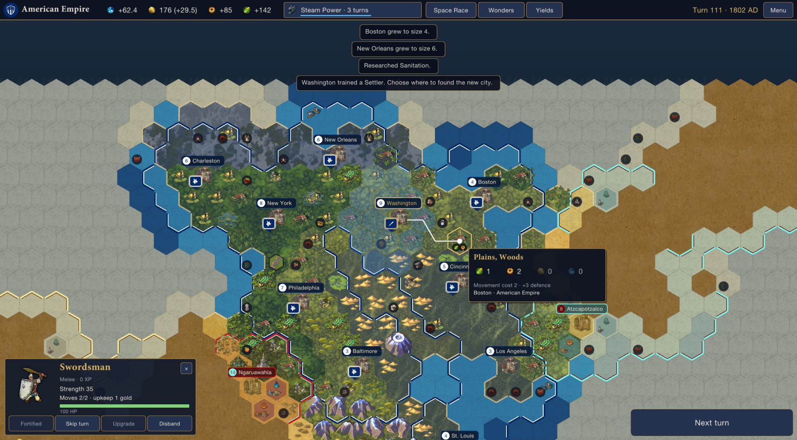
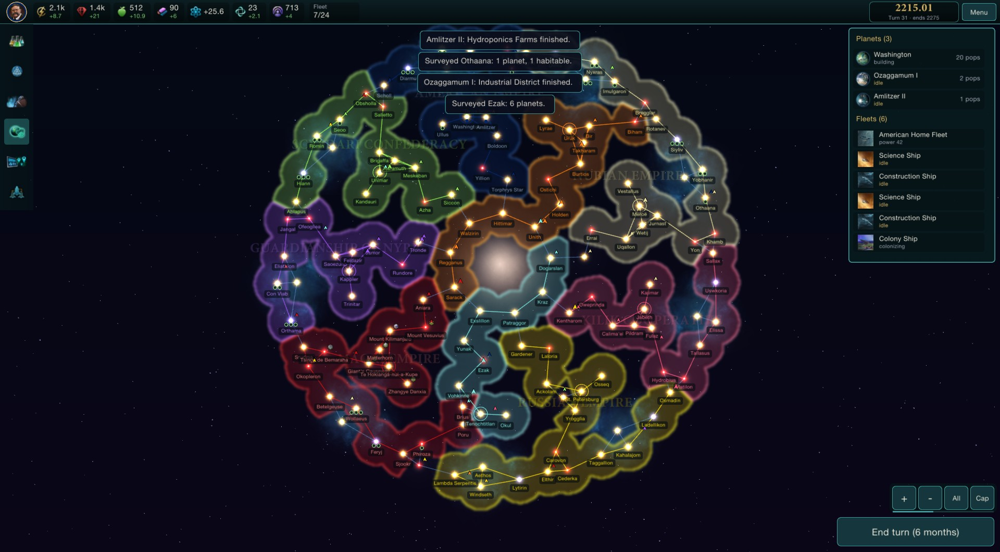

# Stellar Ascension

A two-act strategy game that runs as one program and uses the art and text of your own copies of **Sid Meier's Civilization VI** and **Stellaris**.

- **Act 1** looks and plays like Civ VI, on a smaller scale. You grow a civilization on a hex map, fight your neighbours with units from Warriors to Modern Armor, and race your rivals to the Moon Landing.
- **Act 2** looks like Stellaris but plays in turns. The same civilization, and every surviving rival, carries on across a spiral galaxy.

Stellar Ascension is a standalone game, much like *Grand Galactic*. It doesn't start Civ VI or Stellaris and doesn't change them. It reads their art, names and descriptions from your installs each time it runs, and it ships none of their files.

> Status: **v0.3.0.** Both acts can be played from start to finish. Every check on this PC passes: the self-test, a 10-game simulation matrix, and scripted runs through every screen. See [MODLOG.md](MODLOG.md) for the full test report.

## How a game goes

**Setup.** Pick a civilization and leader from your Civ VI install, then set up both acts.
- **Earth (Act 1):** map size, number of rivals, difficulty, and the **Space Race** level:
  - **Relaxed:** if a rival reaches space first, they start Act 2 owning the rare star systems. Nothing else changes.
  - **Standard:** rivals who reach space before you also start Act 2 with +15% alloys and +10 naval capacity.
  - **Ruthless:** if a rival reaches space first, you lose and there's no Act 2.
- **The galaxy (Act 2):**
  - **Size:** Tiny, Small, Medium, Large or Huge, from about 9 to 24 star systems per empire.
  - **Alien empires:** 0 to 8 of Stellaris's own empires.
  - **AI empires:** Cadet to Grand Admiral (Stellaris's names). This sets how much the AI empires produce and how readily they go to war.
  - **Ends in:** 2250, 2275 or 2300.

**Act 1: from 4000 BC to the Moon Landing.**
- The hex map uses Civ VI's own terrain, features, natural wonders, district, wonder and city art, with fog of war.
- **Resources:** Civ VI's bonus, luxury and strategic resources are on the map, with their own icons and yields. Strategic ones (Horses, Iron, Niter, Oil, Uranium…) appear once you know the tech that reveals them. Every start has food, Horses and Iron nearby.
- **Hover any tile** for a Civ VI-style card: the terrain, the resource, its food, production, gold and science as yield icons, the movement cost, who owns it, and who stands on it. Press **Y** (or the Yields button) to show the yield icons on every tile you can see.
- **Units:** 28 of Civ VI's land units in seven lines (recon, melee, anti-cavalry, ranged, light and heavy cavalry, siege). Their strength, cost, moves, upkeep, required tech and resource are read from your Civ VI.
  - Each line gets stronger through the eras, for example Warrior → Swordsman → Musketman → Line Infantry → Infantry → Mechanized Infantry.
  - Old units become obsolete. You can **upgrade** them for gold inside your borders.
  - Units earn experience and veteran levels (+4 strength each).
- **War:** declare war and make peace from the Space Race window.
  - Borders are closed in peacetime.
  - Combat uses Civ VI's damage curve, with bonuses for hills and woods, fortifying and anti-cavalry.
  - Cities have strength and hit points and fire on nearby enemies. A melee unit takes a city once its hit points reach zero.
  - Rivals go to war too, more readily on harder difficulties. A civilization that loses every city is gone.
- Research Civ VI's real 68-tech tree. Found cities with Settlers. Build buildings, districts and 29 of Civ VI's world wonders.
- Finish with the space projects: **Launch Earth Satellite**, then **Launch Moon Landing**.
- 19 techs carry a **Space Age legacy**: each one you research becomes a starting bonus in Act 2.

**The handoff.** Every civilization still standing becomes a star empire:
- Your homeworld and home system take your capital's name, and the other planets there are named after your largest cities.
- Each world wonder you hold becomes a feature on your homeworld, with a bonus.
- Each natural wonder on the map becomes a rare star system. Whoever reached space first starts out owning them.
- The alien empires you chose join the galaxy.

**Act 2: the galaxy, 2200 onwards, six months per turn.**
- The galaxy is a Stellaris-style spiral with one arm for each empire. Each game it is generated at random, but every arm is a turned copy of the same one, so every empire gets the same neighbourhood. Every empire has exactly 3 habitable worlds within 3 jumps of home.
- **The layout follows Stellaris:**
  - Resources run across the top, with the date on the right.
  - On the left is a menu rail using Stellaris's own navbar icons: Research, Shipyard, Empires, Outliner, Event log, and Next idle fleet.
  - On the right, the outliner lists your planets and fleets.
  - The selected system, or a planet within it, opens in the left column.
- **Zoom smoothly** toward the cursor with the mouse wheel, the **+ / −** keys, or the on-screen buttons. **All** (Home key) shows the whole galaxy, and **Cap** (H) returns to your capital.
  - Zoomed out, each empire's name sits across its territory.
  - Zoomed in, markers under each star show your colonies and free habitable worlds.
- **Hover a system** for its star, owner, planets (with pictures) and the fleets there.
- Survey with science ships, claim systems with outposts, and settle worlds with colony ships.
- Grow your planets with districts and buildings, and research 17 technologies.
- Build corvettes through to battleships. Declare war, take systems, and make peace.
- The game ends at the year you chose, and the highest score wins. You can also win outright by holding 60% of the claimed galaxy and half of every system, after the first 10 years.

## Requirements

- Windows 10 or 11 (64-bit).
- **Sid Meier's Civilization VI** and **Stellaris**, both installed. The base games are enough, and neither game needs to be running.
- The game finds both installs through Steam. If it can't, start it once with `StellarAscension.exe --civ6 "<Civ VI folder>" --stellaris "<Stellaris folder>"`; it remembers the folders after that.

## Install and play

1. Unzip `StellarAscension-0.3.0.zip` anywhere.
2. Run `StellarAscension.exe`.

The game saves on its own every turn. Saves, settings and logs go to `%LOCALAPPDATA%\StellarAscension`.

**Controls**
- **Moving the map:** use **WASD** or the arrow keys, drag with the right or middle mouse button, and zoom with the **mouse wheel**.
- **Act 1:**
  - **Left-click** a unit's flag to select it. Its reach shows in blue and its targets in red.
  - **Right-click** (or left-click a blue tile) to move there. Right-click a far tile for a move over several turns.
  - Click a red target to attack. Hover the target first to see the expected damage.
  - **F** fortifies the selected unit, **Space** skips it, and **Y** toggles the yields lens.
- **Act 2:**
  - **Left-click** to select a system.
  - **Right-click** a system to send the selected fleet. The order depends on the ship: survey, build an outpost, colonise, or move and attack.
  - **R** opens Research, **E** Empires and **L** the Event log. **O** shows or hides the outliner.
- **Enter** ends the turn, and **Esc** closes a window, clears the selection, or opens the menu.
- The big button at the bottom right always says what's needed next ("Choose research", "A unit needs orders", "Next turn"…).

## Building it

Everything is driven by one design sheet, `sheets/design.json`: the rules, Act 1 buildings, wonders and units, Space Age legacies, the galaxy sizes and AI difficulties, Act 2 planets, districts, ships and techs, and which Civ VI or Stellaris asset each picture comes from.

| Part | What it does |
|---|---|
| `sheets/design.json` | The design, as data. **The source of truth.** |
| `tools/preflight.py` | Checks every cell. With the games installed, it also checks that every Civ VI id (techs, units, resources), art name and Stellaris text key really exists. |
| `tools/gen.py` | Turns the sheet into `src/StellarAscension/Generated/Defs.g.cs`. |
| `src/StellarAscension/Assets/` | Readers for Civ VI's `.blp` art packages (including BC1 to BC4 textures and icon atlases), its XML and text databases, and Stellaris's `.dds`, localisation and script files. |
| `src/StellarAscension/Sim/` | The rules of both acts (`Military.cs` holds units and war), the AI, the galaxy generator, the handoff and saves. None of it depends on the screen. |
| `src/StellarAscension/Ui/` | The screens, drawn with raylib. |
| `tools/package.sh` | Preflight → generate → build → self-test → self-contained Windows build → `dist/StellarAscension-<version>.zip`. Needs Python 3 and the .NET 8 SDK. |

**Test modes** (all need both games installed):

| Command | What it does |
|---|---|
| `StellarAscension.exe --selftest` | Checks the asset readers, then plays both acts headless. It checks units, combat, capture, upgrades, peace, resources, the handoff, the galaxy options, saves and Ruthless defeat. |
| `--matrix` | Plays 10 games across the space-race levels, map sizes, rival counts, difficulties, galaxy sizes, alien counts and galaxy AI levels. It covers the player first, middle and last to space, and long non-English names. |
| `--fullbalance N` / `--act1balance N` | Balance reports. |
| `--uiscript tests/ui/<script>.txt --uiout <folder>` | Opens the game window and drives the real screens from a script: `both-acts`, `units`, `galaxy` and `listing-shots`. It presses buttons by their labels, clicks tiles and systems, hovers, plays turns and takes screenshots, then writes a PASS/FAIL log. |
| `--icon NAME[,NAME…]` | Reports whether Civ VI icons decode. |

## Credits

- Art, names and descriptions come from **Sid Meier's Civilization VI** (Firaxis Games / 2K) and **Stellaris** (Paradox Interactive), read at run time from the player's own installs. This is an unofficial fan project and isn't endorsed by either company.
- Built with raylib, Raylib-cs, Pfim and .NET; see [THIRD-PARTY-NOTICES.txt](THIRD-PARTY-NOTICES.txt).
