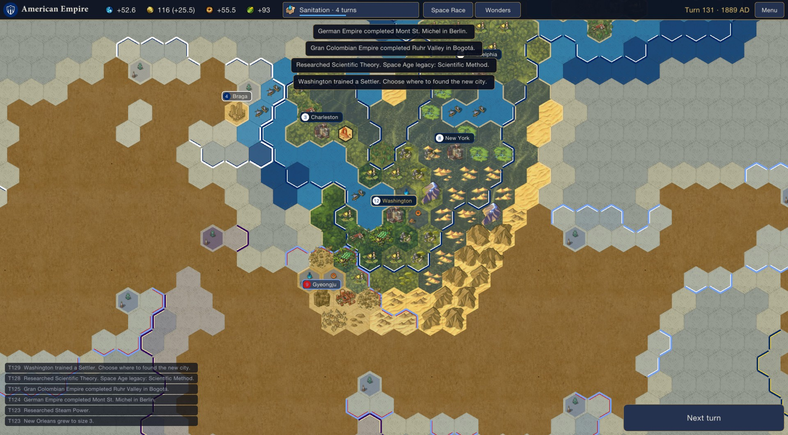

# Stellar Ascension

A two-act strategy game that runs as one program and uses the art and text of your own copies of **Sid Meier's Civilization VI** and **Stellaris**.

- **Act 1** looks and plays like Civ VI, on a smaller scale. You grow a civilization on a hex map and race your rivals to the Moon Landing.
- **Act 2** looks like Stellaris but plays in turns. The same civilization, and every rival, carries on across a spiral galaxy.

Stellar Ascension is a standalone game, much like *Grand Galactic*. It doesn't start Civ VI or Stellaris and doesn't change them. It reads their art, names and descriptions from your installs each time it runs, and it ships none of their files.

> Status: **v0.2.0.** Both acts can be played from start to finish. Every check on this PC passes: the self-test, a 10-game simulation matrix, and a scripted run through both acts' screens. See [MODLOG.md](MODLOG.md) for the full test report.

## How a game goes

**Setup.**
- Pick a civilization and leader from your Civ VI install, along with the map size, number of rivals, difficulty and Act 2 length.
- Then choose a **Space Race** level:
  - **Relaxed:** if a rival reaches space first, they start Act 2 owning the rare star systems. Nothing else changes.
  - **Standard:** rivals who reach space before you also start Act 2 with +15% alloys and +10 naval capacity.
  - **Ruthless:** if a rival reaches space first, you lose and there's no Act 2.

**Act 1: from 4000 BC to the Moon Landing.**
- The hex map uses Civ VI's own terrain, features, natural wonders, district, wonder and city art, with fog of war.
- Research Civ VI's real 68-tech tree. Found cities with Settlers. Build buildings, districts and 29 of Civ VI's world wonders.
- Finish with the space projects: **Launch Earth Satellite**, then **Launch Moon Landing**.
- The rivals play by the same rules as you.
- 19 techs carry a **Space Age legacy**: each one you research becomes a starting bonus in Act 2.

**The handoff.** Every civilization that reaches space becomes a star empire:
- Your homeworld and home system take your capital's name, and the other planets there are named after your largest cities.
- Each world wonder you built becomes a feature on your homeworld, with a bonus.
- Each natural wonder on the map becomes a rare star system. Whoever reached space first starts out owning them.
- A few of Stellaris's own alien empires join the galaxy.

**Act 2: the galaxy, 2200 onwards, six months per turn.**
- The galaxy is a Stellaris-style spiral with one arm for each empire. Each game it is generated at random, but every arm is a turned copy of the same one, so every empire gets the same neighbourhood. Every empire has exactly 3 habitable worlds within 3 jumps of home.
- Survey with science ships, claim systems with outposts, and settle worlds with colony ships.
- Grow your planets with districts and buildings, and research 17 technologies.
- Build corvettes through to battleships. Declare war, take systems, and make peace.
- The game ends at the year you chose (2250, 2275 or 2300) with the highest score winning, or earlier if one empire holds 60% of the claimed galaxy.

## Requirements

- Windows 10 or 11 (64-bit).
- **Sid Meier's Civilization VI** and **Stellaris**, both installed. The base games are enough, and neither game needs to be running.
- The game finds both installs through Steam. If it can't, start it once with `StellarAscension.exe --civ6 "<Civ VI folder>" --stellaris "<Stellaris folder>"`; it remembers the folders after that.

## Install and play

1. Unzip `StellarAscension-0.2.0.zip` anywhere.
2. Run `StellarAscension.exe`.

The game saves on its own every turn. Saves, settings and logs go to `%LOCALAPPDATA%\StellarAscension`.

**Controls**
- Move the map with **WASD** or the arrow keys, and zoom with the **mouse wheel**.
- **Left-click** to select. In Act 2, **right-click** a system to send the selected fleet there; the order depends on the ship (survey, build an outpost, colonise, or move and attack).
- **Enter** ends the turn, and **Esc** opens the menu or closes a window.
- The big button at the bottom right always says what's needed next ("Choose research", "Place your Settler", "Next turn"…).

## Building it

Everything is driven by one design sheet, `sheets/design.json`: the rules, Act 1 buildings and wonders, Space Age legacies, Act 2 planets, districts, ships and techs, and which Civ VI or Stellaris asset each picture comes from.

| Part | What it does |
|---|---|
| `sheets/design.json` | The design, as data. **The source of truth.** |
| `tools/preflight.py` | Checks every cell. With the games installed, it also checks that every Civ VI id, art name and Stellaris text key really exists. |
| `tools/gen.py` | Turns the sheet into `src/StellarAscension/Generated/Defs.g.cs`. |
| `src/StellarAscension/Assets/` | Readers for Civ VI's `.blp` art packages (including BC1 to BC4 textures and atlases), its XML and text databases, and Stellaris's `.dds`, localisation and script files. |
| `src/StellarAscension/Sim/` | The rules of both acts, the AI, the galaxy generator, the handoff and saves. None of it depends on the screen. |
| `src/StellarAscension/Ui/` | The screens, drawn with raylib. |
| `tools/package.sh` | Preflight → generate → build → self-test → self-contained Windows build → `dist/StellarAscension-<version>.zip`. Needs Python 3 and the .NET 8 SDK. |

**Test modes** (all need both games installed):

| Command | What it does |
|---|---|
| `StellarAscension.exe --selftest` | Checks the asset readers, then plays both acts headless and checks the handoff, galaxy, saves and Ruthless defeat. |
| `--matrix` | Plays 10 games across the space-race levels, map sizes, rival counts and difficulties, with the player first, middle and last to space, and long non-English names. It checks every handoff and that every name can be drawn. |
| `--fullbalance N` / `--act1balance N` | Balance reports. |
| `--uiscript tests/ui/both-acts.txt --uiout <folder>` | Opens the game window and drives the real screens from a script. It presses buttons by their labels, clicks tiles and systems, plays turns and takes screenshots, then writes a PASS/FAIL log. |

## Credits

- Art, names and descriptions come from **Sid Meier's Civilization VI** (Firaxis Games / 2K) and **Stellaris** (Paradox Interactive), read at run time from the player's own installs. This is an unofficial fan project and isn't endorsed by either company.
- Built with raylib, Raylib-cs, Pfim and .NET; see [THIRD-PARTY-NOTICES.txt](THIRD-PARTY-NOTICES.txt).
